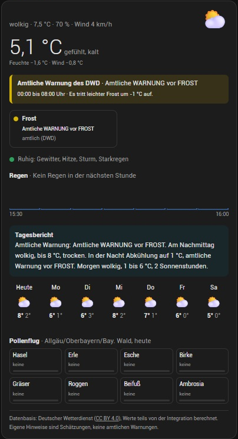

# Wetterlage für Home Assistant


[](https://hacs.xyz)
[](https://github.com/Vandespawn/ha-wetterlage/blob/main/LICENSE)

> **Status: Testversion (0.2.3).** Vorhersage, amtliche Warnungen, Pollenflug, Radar, Sensoren, Wetter-Entität
> und Dashboard-Karte sind da. Ein eigenes Einstellungsfeld in der Seitenleiste folgt; bis dahin lassen sich alle
> Einstellungen unter **Konfigurieren → Alle Einstellungen** als YAML ändern.

Wetterlage holt Vorhersage, amtliche Warnungen, Pollenflug und Regenradar vom Deutschen Wetterdienst,
verbindet sie mit deiner eigenen Wetterstation und rechnet aus, was das für dich heißt:
gefühlte Temperatur, Regen in der nächsten Stunde, Frost, Gewitter, Hitze und ein Tagesbericht auf Deutsch.
Das Ergebnis steht als Entitäten für Automationen bereit und auf einer mitgelieferten Dashboard-Karte.

**Alles ist einstellbar:** Quellen, Sensoren, Rechenmodelle, Schwellenwerte, Texte und jeder Teil der Karte.

[](https://my.home-assistant.io/redirect/hacs_repository/?owner=Vandespawn&repository=ha-wetterlage&category=integration)



## Umfang

| Bereich | Inhalt |
|---|---|
| Vorhersage | DWD MOSMIX-L der nächstgelegenen Station, stündlich und täglich bis 10 Tage, als `weather`-Entität |
| Amtliche Warnungen | DWD-Warnungen für deine Gemeinde und deinen Landkreis, unverändert, mit Stufe 1 bis 4 |
| Pollenflug | DWD-Pollenflug-Gefahrenindex für 8 Pollenarten, heute bis übermorgen |
| Regen nächste Stunde | DWD-Radar-Nowcast (RV) in 5-Minuten-Schritten bis 2 Stunden voraus |
| Gefühlte Temperatur | Windchill, Hitzeindex oder Steadman, mit Sonne; mit Begründung im Attribut `grund` |
| Eigene Hinweise | Frost, Bodenfrost, Glätte, Gewitter, Hitze, Tropennacht, Sturm, Starkregen |
| Tagesbericht | Fließtext auf Deutsch, Bausteine und Reihenfolge wählbar |
| Wetterstation | optional, z. B. Ecowitt; jeder Messwert frei zuordenbar |
| Dashboard-Karte | wird mit der Integration ausgeliefert, kein zweites HACS-Paket |
| Automationen | Ereignisse `wetterlage_warnung` und `wetterlage_hinweis` |

Jede Entität nennt im Attribut `grund`, warum sie diesen Wert hat, und im Attribut `quelle`, woher er stammt.

Alle Einstellungen: [docs/einstellungen.md](https://github.com/Vandespawn/ha-wetterlage/blob/main/docs/einstellungen.md)

## Installation

1. Auf den Knopf **In HACS öffnen** oben klicken – oder in HACS → ⋮ → **Benutzerdefinierte Repositories** →
   `https://github.com/Vandespawn/ha-wetterlage`, Kategorie **Integration**.
2. **Wetterlage** installieren und Home Assistant neu starten.
3. **Einstellungen → Geräte & Dienste → Integration hinzufügen → Wetterlage.**

Voraussetzung: Home Assistant 2026.7 oder neuer.

## Dashboard-Karte

Die Karte kommt mit der Integration, eine Ressource muss nicht angelegt werden.
Im Dashboard: **Karte hinzufügen → Wetterlage**. Im Karten-Editor lässt sich jeder Abschnitt und jedes Element
ein- und ausschalten; die Einstellungen gelten nur für diese eine Karte.

```yaml
type: custom:wetterlage-card
abschnitte: [kopf, warnungen, hinweise, regen, bericht, tage, pollen]  # Auswahl und Reihenfolge
pollen_ausblenden_wenn_keine: true
tage: 5
```

Nach einem Update der Integration die Seite einmal mit **Strg + F5** neu laden.

## Datenquellen und Lizenz

**Datenbasis: Deutscher Wetterdienst**, lizenziert unter [CC BY 4.0](https://creativecommons.org/licenses/by/4.0/deed.de).
Einzelne Werte werden von der Integration aus diesen Daten berechnet.

Die Integration lädt die Daten erst zur Laufzeit direkt vom DWD. Dieses Repo enthält keine DWD-Daten.
Der Code steht unter der [MIT-Lizenz](https://github.com/Vandespawn/ha-wetterlage/blob/main/LICENSE).

Dieses Projekt ist **kein Angebot des Deutschen Wetterdienstes** und wird von ihm weder betrieben noch unterstützt.

Details: [docs/rechtliches.md](https://github.com/Vandespawn/ha-wetterlage/blob/main/docs/rechtliches.md)

## Wichtiger Hinweis

Die gefühlte Temperatur und die eigenen Hinweise sind Schätzungen, keine amtlichen Warnungen.
Sie ersetzen weder die Warnungen des DWD noch die Anweisungen von Behörden. Keine Gewähr für Richtigkeit und Verfügbarkeit.

## Inspiration

Die Idee, Vorhersage, Station und Warnungen zusammenzuführen und zu erklären, stammt von
[Hestia Weather](https://github.com/hestiaFB/hestia-weather-integration) für Frankreich.
Wetterlage ist eine eigenständige Neuentwicklung für Deutschland und übernimmt keinen Code daraus.
